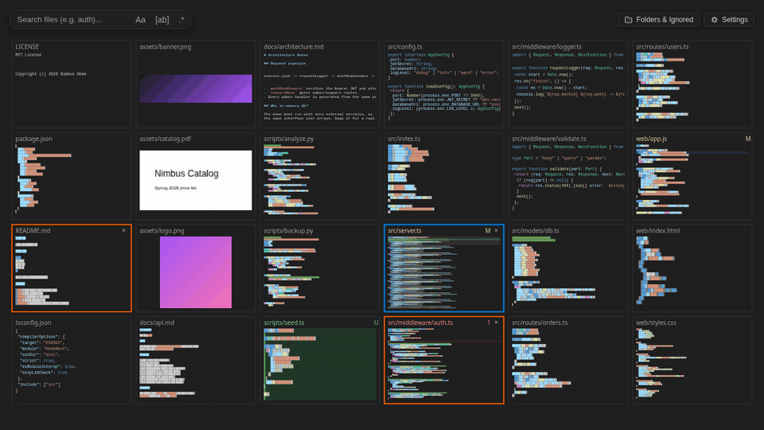
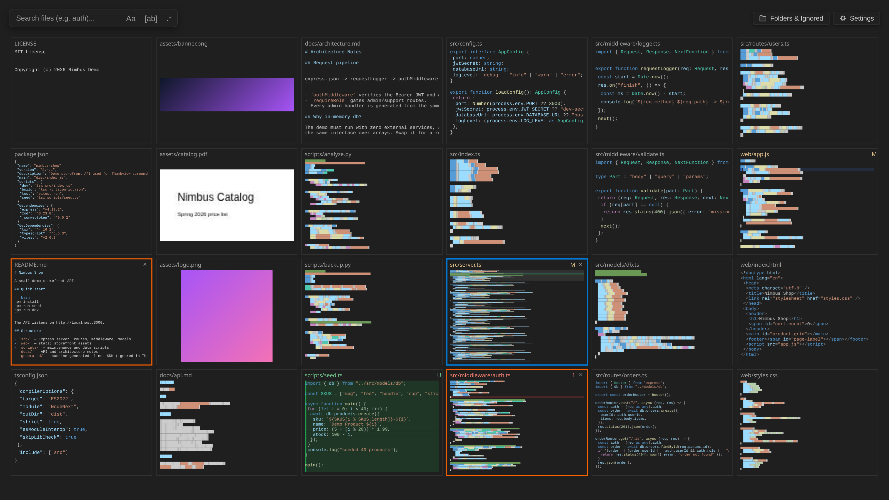
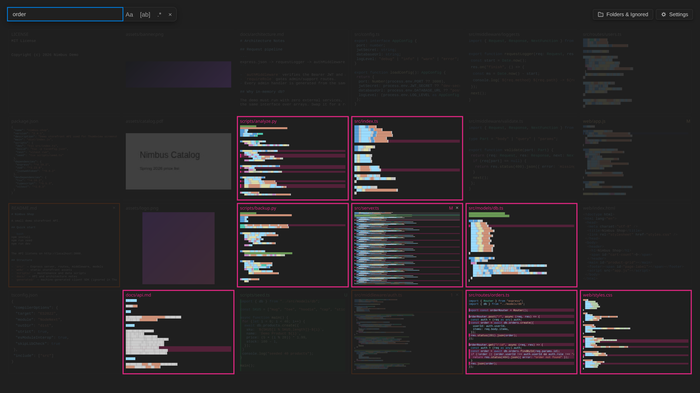
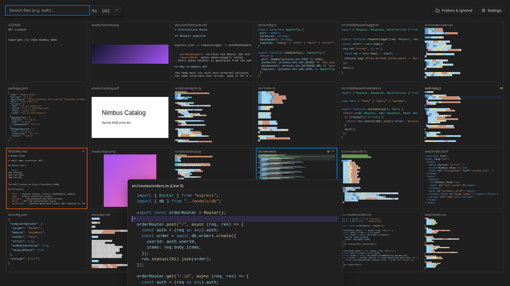
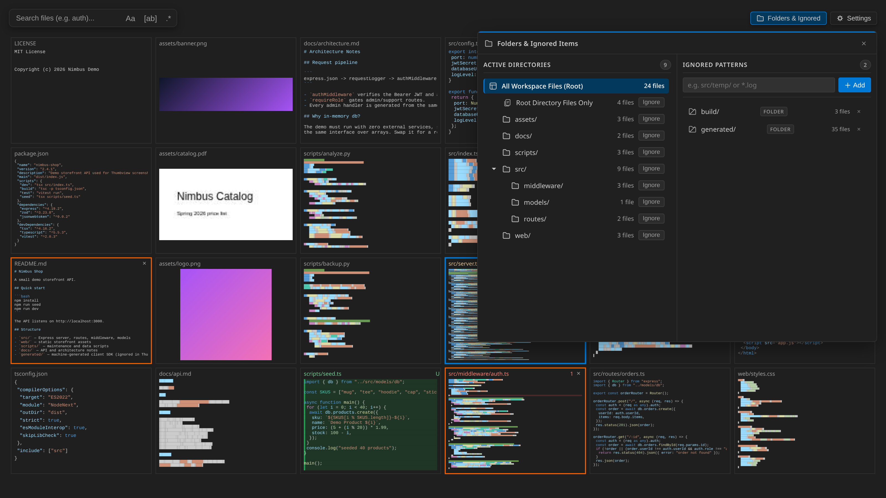

# Thumbview

> Because life's too short to thumb-wrestle with the VS Code sidebar.

A 2D, syntax-highlighted minimap grid of your entire workspace. See every file at once, search across all of them, and jump to any line in one click.

Every file keeps its place in the grid. Adding, ignoring, or editing files never moves the others, so you learn where things are the way you learn a room.

## Setup

1. Install the extension and open a workspace folder.
2. Press `F4`, or run `Thumbview: Open` from the Command Palette, to open the grid. Thumbview scans your workspace automatically with zero configuration.
3. Optional: the **Thumbview** icon in the Activity Bar opens it too; navigation and settings live in Thumbview's own toolbar.
4. New to Thumbview? **Help > Get Started > Get started with Thumbview** walks through the essentials in two minutes.

Change settings via **File > Preferences > Settings > Thumbview** (see [Settings reference](#settings-reference)).

## Core workflow

- **Open the grid.** Press `F4` to open or refocus the tab.
- **Which files appear.** Every text file your project considers source: files not ignored by your `.gitignore` rules (all levels, read through git) or VS Code's `files.exclude` and `search.exclude`. `.git`, `node_modules`, and binary files are always skipped. Hide anything else from the Folders & Ignored menu.
- **Jump to a line.** Click any line on a tile to open the file at that position.
- **Visual recognition.** Tiles display syntax-highlighted minimaps. A colored strip at the top shows the file path.
- **Magnify.** Hold `Left CTRL` and hover over a tile to preview readable code lines without opening the file.
- **Search across all files.** Type in the top search bar to highlight matches across all tiles. `Enter` opens the first match; `↓` moves to it, after which the arrow keys move between matches only. Clear the box or press `×` to reset. Use `Alt+C`, `Alt+W`, or `Alt+X` to toggle match case, whole word, or regex.
- **Close open editors.** Middle-click a tile or click its `×` icon.

## Reading the grid

- **Layout modes.** Spanning grid (default) gives tall files multiple vertical cells so file length is visible at a glance. Uniform grid assigns one equal cell per file. Switch modes from the settings modal or the Command Palette.
- **Folder cards.** When there are too many files for tiles of the minimum size (40×28 px by default), files group into clickable folder cards with mini-mosaic previews. Only adding files does this: expanding the grid space, a file growing, or resizing the window never turns tiles into cards. Click a card to drill down into that folder, and use top breadcrumbs or mouse buttons 3 and 4 to navigate back.
- **Folders and ignored patterns.** Click **Folders & Ignored** in the toolbar to inspect active folders, isolate subdirectories, view ignored globs, and toggle patterns.
- **Resize stability and reflow.** Resizing the window or sidebar scales tiles without reflowing files across columns. To pack empty spaces and remove gaps after moving files, run `Thumbview: Reflow Layout` or click **Reflow Grid** in settings.

## Ignoring and unignoring files

Hide build output, vendor directories, and generated files to keep the grid clear:

- **Toolbar controls.** Click **Folders & Ignored** in the top toolbar to view active patterns, add new globs, or remove patterns.
- **Ignore directories.** In **Folders & Ignored**, click **Ignore** next to a folder.
- **Ignore individual files.** Right-click any tile and select **Ignore in Thumbview**.
- **Unignore items.** Click **Unignore** next to a hidden folder, or remove the pattern from the **Folders & Ignored** list.
- **Auto-ignore threshold.** Folders with more files than `thumbview.autoIgnoreThreshold` (default 30) hide automatically, as do dependency and cache folders (`vendor/`, `venv/`, `.venv/`, `__pycache__/`, `.tox/`, and test or type-checker caches). Folders inside standard source roots such as `src/` are never auto-ignored. Set to `0` to disable auto-ignore entirely. Unhiding an auto-ignored folder saves an exclusion so it stays visible. Raising the threshold shows folders that auto-ignore hid and that no longer exceed it. When folders were auto-hidden, a chip in the grid's bottom-right corner says how many; click it to review them.
- Patterns save to workspace state, keeping rules isolated per repository.

## Additional features

- **Drag and drop reordering.** Drag tiles to swap positions, shift adjacent files, or place files into empty slots. A dragged tile trades places with the same-height block of cells where you drop it (files and empty space alike), and nothing else moves. Configure the default action with `thumbview.dragReorderMode` (`swap` or `shift`).
- **Folder isolation.** Click a folder in the toolbar popover or a tile header to dim other files. Click the root breadcrumb to restore the full view.
- **Root files focus.** Choose **Root Directory Files Only** in the popover to spotlight top-level files like package manifests and configuration files.
- **File operations.** Right-click any tile to open, split, compare, rename, reveal in explorer, or delete, without switching to the file explorer. The outlined tile under the pointer (or the keyboard-focused tile) also takes `F2` (rename), `Ctrl+Enter` / `⌘Enter` (open to the side), `Ctrl+C` / `Ctrl+X` (copy, cut), and `Delete`.

## Shortcuts reference

| Action | Shortcut |
| :--- | :--- |
| **Open / Focus Thumbview** (focuses it where it is if already visible; press again to close) | `F4` (except while the Search view has focus or a references peek is open, where F4 keeps its VS Code meaning). In your own Zen mode, Thumbview opens inside it and leaves it on when it closes. |
| **Code Magnifier** | Hold `Left CTRL` + Hover |
| **Jump to Line** | Left-click a line on a tile |
| **Drag to Reorder** | Click & drag tile to slot |
| **Close Tile Tab** | Middle-click or `×` button |
| **Isolate Folder** | Left-click folder or tile header strip |
| **Context Menu** | Right-click a tile |
| **Navigate History** | Mouse Button 3 (Back) / 4 (Forward) |
| **Move between tiles (keyboard)** | Arrow keys; `Home` / `End` for first / last |
| **Open focused tile** | `Enter` or `Space` (opens the file, or drills into a folder card) |
| **Context menu (keyboard)** | `Shift+F10` or the Menu key; then arrows, `Enter`, and `Escape` |
| **Move focused tile (keyboard)** | `Alt+Arrow` |
| **Magnify focused tile (keyboard)** | Hold `Ctrl` |
| **From search to the results** | `Enter` opens the first match; `↓` focuses it, then arrows move between matches (in folder-card view, the folder holding a match) |
| **Search box** | `Ctrl+F` (`⌘F` on macOS) |
| **Rename / Open to the Side** | `F2` / `Ctrl+Enter` (`⌘Enter` on macOS), on the outlined or focused tile |
| **Copy / Cut / Delete file** | `Ctrl+C` / `Ctrl+X` / `Delete` (`fn+Delete` on macOS), on the outlined or focused tile |

Shortcuts and layout toggles are also accessible from the settings modal in the top-right corner.

## Accessibility

- **Keyboard.** Every tile and folder card can be reached with the arrow keys and opened with `Enter` or `Space`. The context menu, drag reordering, and the magnifier all have keyboard equivalents (see the table above). Typing anything else goes to search.
- **Screen readers.** The focused tile (path, git status, error count, and its column and place in the column), search result counts, and folder changes are announced. The context menu is a standard menu that works with the arrow keys. The toolbar, settings, and folder popovers are labelled dialogs that move and restore focus.
- **Not color alone.** Tiles show git status and error counts as text, for example `2, M` for two errors in a modified file.
- **Themes and motion.** Colors follow your VS Code theme, including high contrast themes. Smooth scrolling on jump follows `workbench.reduceMotion` and your operating system's reduced motion setting.

## What Thumbview changes in VS Code

- **Fullscreen.** Opening Thumbview enters Zen mode and restores your layout when it closes. The first time, a banner explains this and offers **Open as a tab instead**; you can change it later with **Open Fullscreen** in Settings. See `thumbview.fullscreenOnOpen` below for the Zen settings it adjusts.
- **`F4`.** Opens Thumbview, except while the Search view has focus or a references peek is open.
- **Storage.** Layout order, ignore patterns, and folder positions are stored in VS Code's per-workspace extension storage, not in your repository. Options you change in Thumbview's settings panel are saved to your user settings. (Upgrading from a version before 0.2.8 moves its old `thumbview.ignorePatterns` and `thumbview.autoIgnoreExclusions` entries out of `.vscode/settings.json` once.)
- **Privacy & Telemetry.** Thumbview collects no telemetry by default and makes no network requests. You may choose to participate in an optional, opt-in research study on spatial code navigation; even when enrolled, Thumbview never collects code, file names, file paths, or search queries (see [STUDY.md](STUDY.md)). In Restricted Mode it does not run git.
- **Deletes.** Deleting from Thumbview moves files to the trash. Permanent deletion needs a second confirmation.

## Limits

- Up to 10,000 files are shown. Folders with more than `thumbview.autoIgnoreThreshold` files are hidden automatically first. Files already on the grid are always kept when the limit is reached.
- Files larger than 2 MB and binary files are skipped. Very long files are sampled to 2,000 evenly spaced lines for their tile.
- In virtual and remote file systems without git, and in Restricted Mode, git status markers are unavailable and only each folder's root `.gitignore` applies (nested ones do not); `files.exclude` and `search.exclude` still apply.

## Settings reference

| Setting | Default | Description |
| :--- | :--- | :--- |
| `thumbview.layoutMode` | `spanning_grid` | `spanning_grid`: tall files span vertical cells. `uniform_grid`: one equal cell per file. |
| `thumbview.dragReorderMode` | `swap` | `swap`: swap positions with target slot. `shift`: shift adjacent tiles. |
| `thumbview.autoIgnoreThreshold` | `30` | Auto-ignore subfolders with more than this many files (`0` disables). |
| `thumbview.renderMediaThumbnails` | `true` | Render image and PDF thumbnails inside tiles. |
| `thumbview.compressionPercentage` | `5` | Compression threshold: when code shrinks to this percentage of its height in a cell, the tile expands one cell taller (0% disables, 1% to 20% recommended, max 25%). |
| `thumbview.minCellWidth` | `40` | Minimum tile width (px) before files group into folder cards. |
| `thumbview.minCellHeight` | `28` | Minimum tile height (px) before files group into folder cards. |
| `thumbview.fullscreenOnOpen` | `true` | Open Thumbview fullscreen (Zen mode, other editor groups hidden). The first time you open Thumbview in a session it adjusts a few `zenMode.*` settings (no OS fullscreen, no centered layout, no tabs) and restores your values when VS Code closes. Other editor groups are hidden by maximizing Thumbview's group, not through a setting. Until then, Zen mode you enter yourself uses those adjusted settings, and `zenMode.*` changes you make during that session are replaced by your original values. Set to `false` to open Thumbview as a normal editor tab and leave Zen settings untouched. |

## Third-party software

PDF previews use [pdf.js](https://mozilla.github.io/pdf.js/) 6.3.289 (legacy build) by Mozilla, under the Apache License 2.0 (`media/pdfjs/LICENSE` in the installed extension).

## Feedback

Report bugs and request features at [github.com/jjoseph357/thumbview-issues](https://github.com/jjoseph357/thumbview-issues/issues). Questions are welcome in the **Q&A** tab of Thumbview's Marketplace page.

If opening files feels slow, **View > Output > Thumbview** shows how long each open took and where the time went; including it in a report helps.
