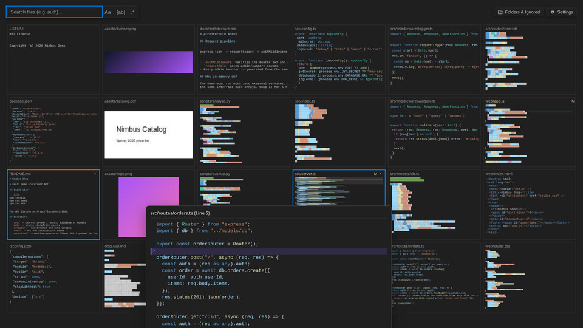

# Read a file without opening it

Hold **Left Ctrl** and move over any tile. A magnifier shows the real code under the pointer, with syntax highlighting and search matches.

Keyboard: move to a tile with the arrow keys, then hold **Ctrl**.
