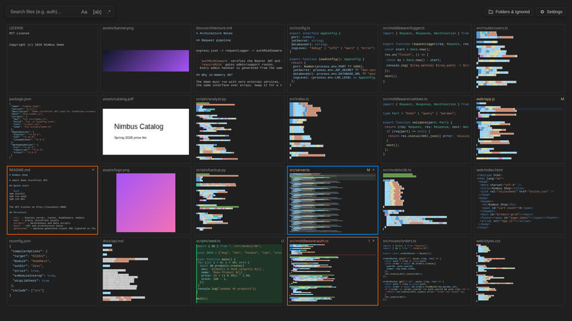

# Your whole workspace, at a glance

Press **F4** (or your own shortcut for **Thumbview: Open**) anywhere in VS Code. Every file appears as a tile, and each tile keeps its place, so after a few days you will reach for files by where they are, the way you find things in a familiar room.

Press **F4** again, or **Esc**, to go back to exactly where you were.
