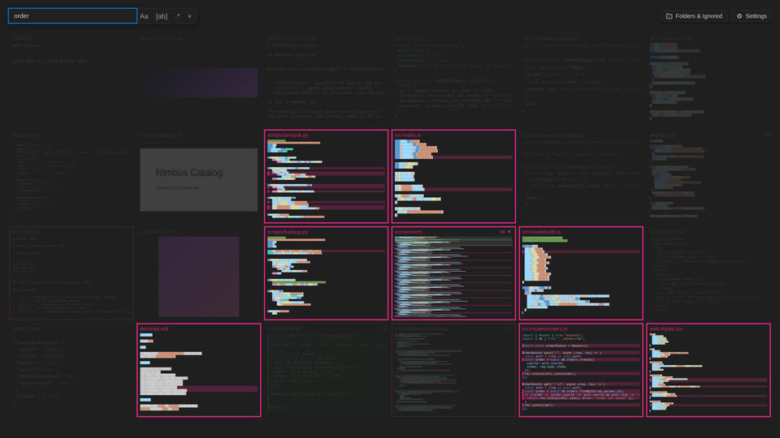

# Search without a search box

With Thumbview open, **just start typing**. Every file and every line that matches lights up across the whole grid as you type.

- `Enter` opens the first match; `↓` moves to it, and the arrow keys then move between matches only
- `Alt+C` match case, `Alt+W` whole word, `Alt+X` regular expression
- `Ctrl+F` returns to the search box, `Ctrl+Backspace` clears it
